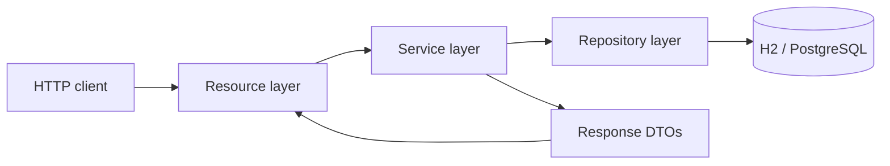
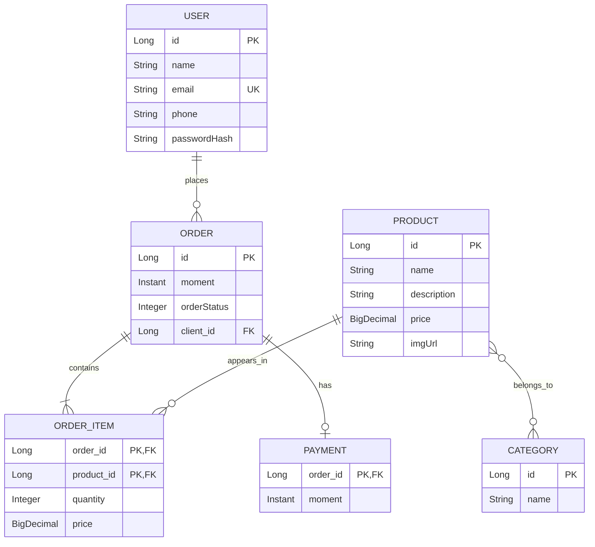

<div align="center">

# Spring Boot JPA Workshop

**An order management REST API built with Java 25, Spring Boot and Hibernate.**

Users, products, categories, orders and payments connected through a relational domain model.


[](https://github.com/Luciano-alvesjr/springboot-jpa-workshop/actions/workflows/ci.yml)

[Overview](#overview) · [Architecture](#architecture) · [Getting started](#getting-started) · [API](#api-reference) · [Tests](#testing) · [Credits](#credits)

</div>

## Overview

This project implements the web services workshop from **Nelio Alves's Java course (DevSuperior)**. It brings the course's domain model into a running API, with database seeding, user CRUD operations and consistent HTTP error responses.

The focus is backend development: modeling relationships with JPA, separating HTTP handling from business logic, and persisting data through Spring Data repositories. It also includes input validation, automated tests and a reproducible Maven build.

### Features

- Create, retrieve, update and delete users.
- Browse products and their categories.
- Retrieve orders with their client, purchased items, payment and calculated total.
- Map one-to-many, many-to-many and shared-primary-key one-to-one relationships.
- Store order items with a composite key and the price at the time of purchase.
- Start locally with H2 and the sample dataset from the course.
- Switch to PostgreSQL through environment variables.
- Return structured `400`, `404` and `409` responses.
- Hash passwords with BCrypt and exclude them from every response.

> Educational backend project. Authentication, authorization, checkout, payment processing and a frontend are outside the workshop's scope. The API should be run locally or in a controlled development environment.

## Technology stack

| Component | Technology |
| --- | --- |
| Language | Java 25 |
| Framework | Spring Boot 4.1.1 / Spring Web MVC |
| Persistence | Spring Data JPA / Hibernate |
| Databases | H2 for the default demo; PostgreSQL for development |
| Validation | Jakarta Bean Validation |
| Password hashing | Spring Security Crypto / BCrypt |
| Build | Maven Wrapper (Maven 3.9.16) |
| Tests | JUnit, MockMvc, AssertJ and H2 |
| Automation | GitHub Actions |
| Coverage report | JaCoCo |

## Architecture



| Layer | Responsibility |
| --- | --- |
| `resources` | REST endpoints, status codes and request validation |
| `services` | Use cases, transactions and response mapping |
| `repositories` | Database access with Spring Data JPA |
| `entities` | Domain objects, persistence mappings and calculated totals |
| `dto` | Explicit request and response contracts |
| `config` | Demo database seeding and password encoder configuration |

Open Session in View is disabled. Services build response DTOs inside transactions, so JSON serialization does not depend on an open persistence session or expose recursive entity graphs.

### Domain model



`OrderItemPK` combines the order and product. `Payment` shares its primary key with its order using `@MapsId`. Products and categories are connected through `tb_product_category`.

Money uses `BigDecimal` and `DECIMAL(19,2)` columns. An item's stored price is independent of later catalog price changes. Item subtotals and order totals are calculated, not duplicated in database columns.

Order statuses use explicit database codes: `1` waiting for payment, `2` paid, `3` shipped, `4` delivered and `5` canceled. JSON responses expose the corresponding enum names.

## Getting started

### Requirements

- JDK **25**.
- Internet access for the first Maven Wrapper run.
- PostgreSQL only if you select the `dev` profile.

### Run with the seeded H2 database

```bash
git clone https://github.com/Luciano-alvesjr/springboot-jpa-workshop.git
cd springboot-jpa-workshop
```

**Windows PowerShell**

```powershell
.\mvnw.cmd spring-boot:run
```

**macOS / Linux**

```bash
./mvnw spring-boot:run
```

The API starts at **http://localhost:8080**. Try `GET /orders/1` or open the requests in [`docs/requests.http`](docs/requests.http) with an HTTP client that supports `.http` files.

The default `test` profile is a disposable demo environment. It recreates and seeds the database on every application restart.

### H2 console

Open **http://localhost:8080/h2-console** while the default profile is running.

| Setting | Value |
| --- | --- |
| JDBC URL | `jdbc:h2:mem:workshop` |
| User | `sa` |
| Password | Leave empty |

Remote access to the console is disabled. The console is disabled entirely in the PostgreSQL profiles.

### Run with PostgreSQL

Create the local database:

```sql
CREATE DATABASE springboot_course;
```

Set the connection variables in your shell or IDE. PowerShell example:

```powershell
$env:SPRING_PROFILES_ACTIVE = "dev"
$env:DB_URL = "jdbc:postgresql://localhost:5432/springboot_course"
$env:DB_USER = "postgres"
$env:DB_PASSWORD = "your-local-password"
.\mvnw.cmd spring-boot:run
```

The `dev` profile updates the local schema and starts with an empty database. Demo data is seeded **only** in the `test` profile. You can create users through the API; catalog and order write operations are outside the course scope.

Use [`.env.example`](.env.example) as a reference. Spring Boot does not load that file automatically: export the variables or configure them in the IDE. Keep real credentials out of Git.

### Profiles

| Profile | Database | Schema behavior | Seed data |
| --- | --- | --- | --- |
| `test` (default) | H2 in memory | `create-drop` | Course fixtures |
| `dev` | PostgreSQL | `update` | None |
| `prod` | PostgreSQL | `validate` | None |

The `prod` configuration is a starting point, not a deployment. It requires `DB_URL`, `DB_USER`, `DB_PASSWORD` and an existing schema. Add schema migrations, access control and an operational deployment configuration before production use. No paid hosting is provisioned by this project.

## API reference

Base URL: `http://localhost:8080`

| Method | Endpoint | Behavior | Success |
| --- | --- | --- | --- |
| GET | `/users` | List users | `200` |
| GET | `/users/{id}` | Find a user | `200` |
| POST | `/users` | Create a user | `201` + `Location` |
| PUT | `/users/{id}` | Replace name, email and phone | `200` |
| DELETE | `/users/{id}` | Delete a user without orders | `204` |
| GET | `/products` | List products and categories | `200` |
| GET | `/products/{id}` | Find a product | `200` |
| GET | `/categories` | List categories | `200` |
| GET | `/categories/{id}` | Find a category | `200` |
| GET | `/orders` | List orders | `200` |
| GET | `/orders/{id}` | Find an order, items, payment and total | `200` |

Collections are returned in ID order and are not paginated. IDs must be positive integers. Product, category and order resources are read-only in this workshop.

### Create a user

```http
POST /users
Content-Type: application/json

{
  "name": "Bob Brown",
  "email": "bob@gmail.com",
  "phone": "977557755",
  "password": "123456"
}
```

```json
{
  "id": 3,
  "name": "Bob Brown",
  "email": "bob@gmail.com",
  "phone": "977557755"
}
```

IDs are generated by the database and may differ. Name, email, phone and password are required. Name is limited to 120 characters, email to 254 and phone to 30. Passwords must have 6–72 characters and fit within BCrypt's 72-byte UTF-8 limit. Email addresses are normalized to lowercase and must be unique. Sample passwords are educational fixtures, not recommended real passwords.

### Update a user

```http
PUT /users/3
Content-Type: application/json

{
  "name": "Bob Updated",
  "email": "bob.updated@gmail.com",
  "phone": "977557755"
}
```

All three fields are required. Updating a user preserves the existing password and order history. Password changes are not supported by this endpoint.

### Retrieve an order

`GET /orders/1` returns:

```json
{
  "id": 1,
  "moment": "2019-06-20T19:53:07Z",
  "orderStatus": "PAID",
  "client": {
    "id": 1,
    "name": "Maria Brown",
    "email": "maria@gmail.com",
    "phone": "988888888"
  },
  "items": [
    {
      "productId": 1,
      "productName": "The Lord of the Rings",
      "quantity": 2,
      "price": 90.50,
      "subTotal": 181.00
    },
    {
      "productId": 3,
      "productName": "Macbook Pro",
      "quantity": 1,
      "price": 1250.00,
      "subTotal": 1250.00
    }
  ],
  "payment": {
    "id": 1,
    "moment": "2019-06-20T21:53:07Z"
  },
  "total": 1431.00
}
```

Unpaid orders return `"payment": null`. Payment records represent the course dataset; the application does not process transactions.

### Error responses

| Status | Examples |
| --- | --- |
| `400 Bad Request` | Invalid fields, malformed JSON or invalid IDs |
| `404 Not Found` | User, product, category or order does not exist |
| `409 Conflict` | Duplicate email or deletion of a user referenced by orders |

```json
{
  "timestamp": "2026-10-27T12:00:00Z",
  "status": 404,
  "error": "Not Found",
  "message": "User not found. Id: 99999",
  "path": "/users/99999",
  "errors": []
}
```

Validation responses also include field-level messages in `errors`. Database errors do not expose SQL or connection details.

## Demo dataset

| Resource | Initial data |
| --- | --- |
| Users | Maria Brown and Alex Green |
| Categories | Electronics, Books and Computers |
| Products | The Lord of the Rings, Smart TV, Macbook Pro, PC Gamer and Rails for Dummies |
| Orders | Three orders, four line items and one payment |

| Order | Status | Total |
| --- | --- | --- |
| 1 | `PAID` | `1431.00` |
| 2 | `WAITING_PAYMENT` | `2500.00` |
| 3 | `WAITING_PAYMENT` | `201.98` |

## Testing

**Windows**

```powershell
.\mvnw.cmd clean verify
```

**macOS / Linux**

```bash
./mvnw clean verify
```

The test suite runs against H2 with the seeded domain. It verifies:

- The complete user CRUD lifecycle and the `Location` header.
- Password hashing, hidden passwords and email normalization.
- Missing resources, invalid input and duplicate email conflicts.
- Foreign-key protection when deleting users with existing orders.
- Product/category relationships and order/payment serialization.
- Exact decimal totals and historical item prices.
- Explicit enum persistence codes.

JaCoCo writes an HTML coverage report to `target/site/jacoco/index.html` after `verify`. GitHub Actions runs the same Maven verification on pushes and pull requests. PostgreSQL connectivity and schema behavior require a separate local PostgreSQL check; the automated suite uses H2.

### Package an executable JAR

```powershell
.\mvnw.cmd clean package
java -jar target/springboot-jpa-workshop-1.0.0.jar
```

The default demo profile still applies when running the JAR.

## Project structure

```text
src/
├── main/
│   ├── java/com/luciano/workshop/
│   │   ├── config/
│   │   ├── dto/
│   │   ├── entities/
│   │   │   ├── enums/
│   │   │   └── pk/
│   │   ├── repositories/
│   │   ├── resources/
│   │   │   └── exceptions/
│   │   ├── services/
│   │   │   └── exceptions/
│   │   └── WorkshopApplication.java
│   └── resources/
└── test/java/com/luciano/workshop/
```

## Course scope and implementation choices

The domain, sample data, logical layers, user CRUD and exception handling follow the course workshop. This implementation adds explicit DTOs, Bean Validation, BCrypt password hashing, exact decimal arithmetic, automated tests and CI. PostgreSQL configuration is included; the optional paid Heroku deployment is not performed.

Possible next steps include pagination, PostgreSQL integration tests, schema migrations, authentication and authorization. These are future improvements, not current features.

## Credits

Based on the **Web Services with Spring Boot and JPA / Hibernate** workshop from [Nelio Alves / DevSuperior](https://devsuperior.com.br/), part of the Java course.

Course reference: [acenelio/workshop-springboot4-jpa](https://github.com/acenelio/workshop-springboot4-jpa).

Project maintained by [Luciano Alves Jr.](https://github.com/Luciano-alvesjr).
